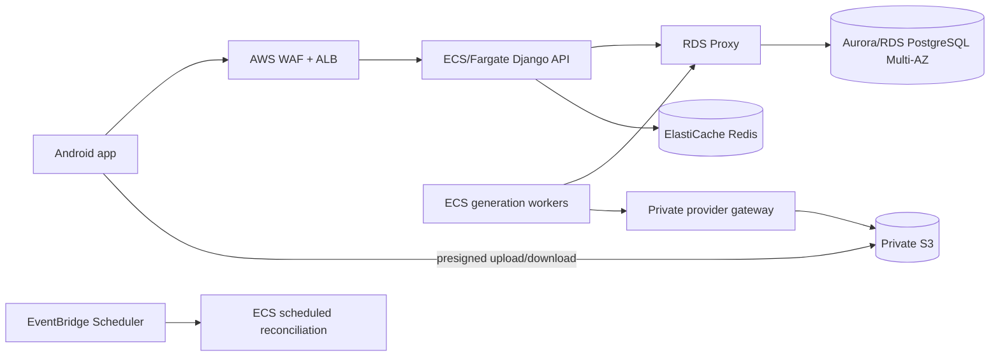

# AWS production architecture

## Database choice

Use **Amazon Aurora PostgreSQL or RDS PostgreSQL**, not a database installed on an EC2/ECS application server. PostgreSQL transactions and row locks protect wallets, idempotency, budgets, jobs and purchase tokens. Start with Multi-AZ, encryption, automated backups/PITR and deletion protection. Put **RDS Proxy** in front of it; Django uses `CONN_MAX_AGE=0` so the proxy pools connections across ECS tasks. Add read replicas only for measured read pressure; all financial and job writes stay on the writer.

Use other AWS stores for their own jobs:

- S3: private input/output media, multipart/direct uploads, lifecycle expiration and no media bytes through Django.
- ElastiCache Redis Multi-AZ: shared rate counters and short authentication caches. It is never the financial source of truth.
- PostgreSQL: accounts, wallets, immutable ledger, quotes, purchase tokens, durable job outbox and media ownership metadata.

## Request path

Run API and generation workers as separate ECS services and images/commands. API autoscaling should use ALB request count, p95 latency, CPU and memory. Worker autoscaling should use queued-job age and count with a hard maximum derived from provider quotas and the daily budget. Workers claim PostgreSQL rows with `SELECT … FOR UPDATE SKIP LOCKED`; API requests never wait for AI generation.

Secrets Manager holds Django/JWT secrets, the gateway token, billing encryption key and Play service credential. ECS task roles grant least-privilege S3/KMS/Secrets permissions. API tasks have no provider credential; only worker tasks can reach the private gateway. Place ECS, RDS, proxy and Redis in private subnets; expose only the ALB. Restrict the task security group to the ALB and only then enable `MOTION_AI_BEHIND_ALB=true`.

## One million concurrent users

This design can scale horizontally toward that target, but source code cannot certify one million concurrent users. Define and test these separately:

- one million installed or signed-in accounts;
- one million open app sessions with almost no traffic;
- peak API requests per second and response mix;
- simultaneous uploads/downloads (mostly S3 capacity);
- simultaneous paid generation jobs (bounded by provider quota and budget).

One million clients polling every 30 seconds would be roughly 33,333 requests/second, so do not allow every idle app to poll. Poll only active jobs with backoff, send completion through FCM, cache public capabilities at CloudFront/API Gateway when appropriate, and enforce per-account active-job limits. Before claiming capacity, run staged load tests in a non-production AWS account at 1%, 5%, 20% and target load; observe ALB, ECS, RDS Proxy, PostgreSQL locks/IOPS, Redis, S3, provider quota and cost. Abort tests automatically at budget and error thresholds.

## Required production checks

Run migrations as a single ECS deployment task before rolling API tasks. Require `/ready` for target health and `/health` for liveness. Configure WAF managed rules, body-size limits and login/IP rate limits. Add CloudWatch structured logs with no tokens/prompts, metrics for quote/job/ledger transitions, alarms for uncertain jobs, budget exhaustion, settlement mismatches, database saturation and purchase reconciliation failures. Enable CloudTrail, GuardDuty, RDS/S3 audit events and restore drills.

Blue/green deploy the Django API. Keep the old Node login read-only during account export, dry-run `import_motion_accounts`, stop old writes, take a final export, apply it, then switch the Android/API DNS. Sessions are not migrated: every account signs in again. Retain the old database until counts and sampled accounts are reconciled and the rollback window closes.

Primary references: [Amazon RDS Proxy](https://docs.aws.amazon.com/AmazonRDS/latest/UserGuide/rds-proxy.html), [Amazon RDS Multi-AZ](https://aws.amazon.com/rds/features/multi-az/), [Django deployment checklist](https://docs.djangoproject.com/en/5.2/howto/deployment/checklist/), [Django row locking](https://docs.djangoproject.com/en/5.2/ref/models/querysets/#select-for-update), and [Google Play backend purchase verification](https://developer.android.com/google/play/billing/security).
